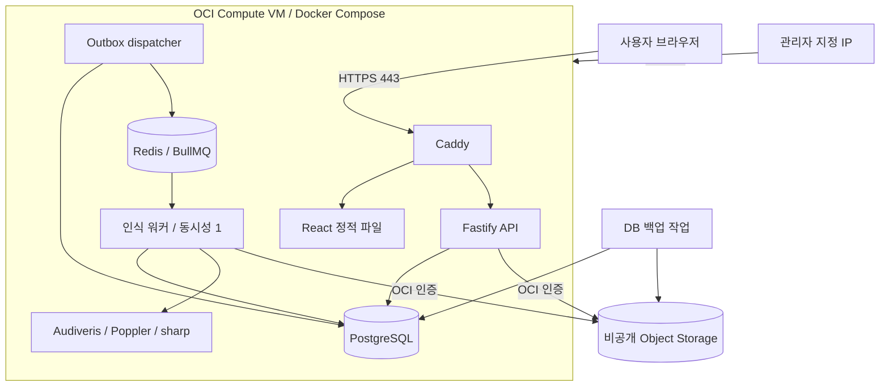

# Scorebridge OCI 인프라 구성

- 작성일: 2026-10-11
- 상태: 구성 계획. 클라우드 자원 생성·배포는 아직 수행하지 않음.
- 기준: [제품 기획](./product-plan.md), [기술 설계](./technical-design.md)
- 결정: Oracle Cloud Infrastructure(OCI)를 사용하며, PoC는 무료 자원 범위 안에서 구성한다.

## 1. 목표와 전제

웹·API·악보 인식 워커·PostgreSQL·Redis를 하나의 VM에서 Docker Compose로 실행한다. 인식은 한 번에 한 페이지부터 처리한다. 초기에는 Kubernetes, 관리형 Redis, 관리형 DB, 유료 로드밸런서를 사용하지 않는다.

무료 운영은 해당 계정과 리전의 자원 할당 및 사용량이 무료 범위에 들어갈 때 가능한 목표다. 자원 확보·가동률·무료 정책의 영속성을 보장하는 의미는 아니다. 유료 자원으로 자동 전환하지 않고 필요할 때 별도로 결정한다.

첫 배포 전에 확인할 사항:

- 홈 리전, 계정 유형, 콘솔의 무료 대상 표시와 서비스 한도
- Ampere A1 생성 가능 여부 및 Linux ARM64 인식 엔진 호환성
- 도메인 사용 여부와 TLS 인증서 발급 경로
- 파일·DB 백업 공간 및 복원 방법

## 2. 구성도

외부 진입점은 Caddy 한 곳으로 모은다. API·DB·Redis·워커는 컨테이너 내부 네트워크에서 통신한다. VM에는 public IP를 부여하되 DB·Redis 포트를 외부에 공개하지 않는다.

## 3. OCI 자원 계획

| 자원 | 초기 구성 | 확인 사항 |
| --- | --- | --- |
| Compartment | scorebridge-poc | 프로젝트 자원·권한·비용을 한 곳에서 관리 |
| VCN | 1개, 충돌 없는 사설 주소 대역 | public subnet, Internet Gateway, route 설정 |
| Subnet | VM용 public subnet 1개 | 별도 NAT Gateway는 초기 구성에 불필요 |
| NSG | VM 전용 1개 | 웹 공개, SSH는 지정 IP만 허용 |
| Compute | VM.Standard.A1.Flex 후보, 2 OCPU·12GB | 계정 한도와 ARM64 실행 검증 후 채택 |
| OS | Ubuntu LTS 후보 | Audiveris 및 컨테이너 의존성 지원 확인 |
| Boot Volume | 50GB, 무료 대상 확인 | OS·컨테이너 이미지 저장 |
| Data Volume | 50GB 제안, 무료 대상 확인 | DB·Redis 영속 데이터·임시 처리 공간 |
| Object Storage | private Standard bucket 2개 | 악보 파일과 DB 백업의 권한·보관 분리 |

Boot와 Data 합계 100GB를 초기 제안으로 잡아 무료 디스크 범위에 여유를 둔다. Balanced 등 볼륨 성능 설정도 무료 조건에 포함되는지 확인하며, 추가 성능 옵션을 임의로 켜지 않는다.

무료 전용 계정의 공식 A1 문서는 월 1,500 OCPU시간·9,000 GB시간, 총 2 OCPU·12GB에 해당하는 범위를 안내한다. 다른 계정 유형·기존 자원 사용량에 따라 실제 적용은 콘솔에서 다시 확인한다. 오래된 4 OCPU·24GB 안내를 기본값으로 사용하지 않는다.

### ARM64 실행 검증

Java 프로그램이라는 이유만으로 ARM64 호환성을 가정하지 않는다. Audiveris와 OCR 등 네이티브 의존성을 포함한 Linux ARM64 이미지에서 샘플 악보를 변환한다.

검증 항목은 headless 실행, PDF 변환, MusicXML 생성, 출력 렌더링, 최고 메모리, 처리 시간이다. 실패하면 로컬에서 PoC를 계속 진행하며 x86_64 유료 VM 채택 여부를 별도로 결정한다. 무료 AMD Micro VM으로 전체 구성을 옮기면 충분하다고 가정하지 않는다.

## 4. 컨테이너와 자원 관리

| 서비스 | 역할 | 운영 방식 |
| --- | --- | --- |
| caddy | TLS 종료, 정적 파일, API reverse proxy | 80·443만 웹 공개 |
| api | 업로드·작업·권한·파일 제공 | 내부 포트, health check |
| dispatcher | outbox 전달 | DB commit 이후 전송 복구 |
| worker | 인식·검증·export | 동시성 1, 실행 시간 제한 |
| postgres | 상태·수정 버전 | Data Volume에 영속 저장 |
| redis | 작업 전달 | AOF 영속화, 큐 eviction 금지 |
| maintenance | 파일 정리·DB 백업 | 예약 실행, 실패 기록 |

VM의 12GB를 전부 워커에 배정하지 않는다. 초기 메모리 상한은 워커 6GB, DB 1.5GB, Redis 512MB, API·dispatcher 합계 1GB를 출발점으로 측정한다. 나머지는 OS·proxy·일시적인 사용량을 위한 여유다. 실제 프로세스 최대 RSS와 OOM 여부를 기준으로 조정한다.

Java heap은 워커 컨테이너 상한보다 낮게 설정해 네이티브 메모리 여유를 남긴다. CPU 사용도 웹 요청 처리를 고려해 제한한다. Redis의 데이터 maxmemory는 컨테이너 메모리보다 낮게 잡고 noeviction을 사용한다. 큐가 가득 차면 새 작업을 거절하거나 대기시키며 이미 접수된 작업을 삭제하지 않는다.

DB가 작업 상태의 기준이다. Redis나 워커 재시작 시 outbox와 실행 기한을 기준으로 복구하며, 큐의 영속화만으로 무손실을 보장하지 않는다. DB·Redis는 외부에 노출하지 않고 자격 증명을 적용한다.

## 5. 네트워크와 접근 제어

- 인바운드 443: 공개 HTTPS.
- 인바운드 80: HTTPS redirect 및 인증서 발급에 필요한 경우만 공개.
- 인바운드 22: 관리자 지정 IP CIDR만 허용, SSH key 사용.
- API 개발 포트·5432·6379: public interface에 publish하지 않는다.
- NSG뿐 아니라 subnet security list와 호스트 방화벽의 허용 규칙도 확인한다.
- IPv6를 사용할 경우에도 동일한 접근 제한을 적용한다.

같은 origin에서 웹과 `/api`를 제공해 CORS와 세션 구성을 단순화한다. VM 관리자가 앱 사용자 계정과 구분되도록 한다. PoC가 공개 주소를 가진다면 개발용 owner를 모든 방문자가 공유하는 설정으로 배포하지 않는다. 인증이 준비될 때까지 VPN·접근 제한 또는 별도 테스트 인증으로 보호한다.

커스텀 도메인을 구매하면 등록·갱신 비용은 별도다. TLS는 무료 ACME 인증서를 사용하되 발급 가능한 이름과 경로를 배포 시 확인한다. 도메인 구매 없이 시작할 경우 검증된 접속 주소·인증서 방식을 선택하고 HTTPS를 생략하지 않는다.

## 6. 파일 저장과 OCI 권한

악보 원본, 썸네일, 결과 XML, 수정본, export ZIP은 비공개 bucket에 저장한다. 인식 중간 파일은 워커의 임시 영역에 두고 작업 종료 후 삭제한다. 결과의 object key는 사용자 파일명 대신 내부 ID로 만든다.

OCI 접근은 가능하면 instance principal과 최소 범위 IAM policy를 사용한다. 컨테이너에서 자격 증명 접근과 격리가 가능한지 확인한다. 앱 bucket과 backup bucket의 권한을 분리하고, backup 삭제 권한은 일상적인 앱 실행 권한에 포함하지 않는다.

StorageAdapter는 OCI native SDK 구현을 우선한다. S3 호환 API를 사용할 경우 필요한 고객 secret key 관리가 추가되므로 실제로 필요한 기능과 비교해 결정한다. 비밀 값과 서명 URL을 저장소나 로그에 넣지 않는다.

보관 기준:

- 작업 악보: 생성 후 7일, 사용자 삭제 요청 시 즉시 접근 차단 후 비동기 제거.
- 작업 임시 파일: 완료·실패 직후 제거, 고립 파일은 매일 청소.
- DB 백업: 최근 7일 일별 보관을 초기 제안으로 사용.
- 삭제·만료된 악보의 수정 XML은 파일로 분리하고 DB에는 참조·최소 메타데이터만 보관.
- 백업 안의 삭제 메타데이터는 백업 보관 기간 종료까지 남을 수 있다. 복원 시 삭제·만료 상태를 다시 적용한다.

Object Storage lifecycle은 정리 실패에 대비한 보조 수단이다. prefix별 보관 기간을 적용하고 DB의 삭제 정책과 충돌하지 않도록 한다. versioning을 켜면 이전 버전에도 별도 정리 정책과 저장 비용이 필요하다.

## 7. 무료 범위와 과금 가능 항목

Redis와 PostgreSQL을 직접 실행하는 데 관리형 서비스 사용료는 없다. 사용한 VM·디스크·네트워크 비용은 별개다.

| 항목 | 초기 비용 목표 | 과금 가능 지점 |
| --- | --- | --- |
| Compute | 무료 대상 A1 | 무료 한도 초과, 다른 shape·추가 VM |
| Block Volume | 무료 한도 내 | 부팅·데이터 볼륨 합계, 성능 옵션, 백업 한도 초과 |
| Object Storage | 무료 한도 내 | 계정별 저장량·API 요청 한도 초과 |
| 인터넷 전송 | 무료 한도 내 | 무료 외부 전송량 초과, 별도 전송 경로 |
| Redis·PostgreSQL | self-hosted | 관리형 Redis·DB 생성 |
| TLS | 무료 인증서 | 유료 인증서 선택 |
| 도메인 | 선택 | 구매·갱신 |
| 로그·이미지 registry | 최소 사용 | 유료 수집·장기 보관·저장량 증가 |
| 메일·외부 인증·AI API | 초기 미사용 | 유료 서비스 또는 무료 한도 초과 |

공식 문서 기준 무료 Block Volume은 부팅·데이터 합계 200GB와 볼륨 백업 5개다. 무료 전용 계정의 Object Storage는 합계 20GB와 월 50,000 API 요청이 안내되며 계정 유형별 조건이 다르다. 외부 인터넷 전송은 월 10TB 무료 범위가 안내된다. 계정·리전·SKU 기준을 콘솔과 가격표에서 확인한다.

페이지마다 여러 artifact가 생기므로 원본 업로드 수만으로 요청량을 추정하지 않는다. 총 저장량은 원본 + 썸네일 + XML 수정 버전 + ZIP + 백업으로 계산한다. 파일 상태 polling은 DB에만 수행해 Object Storage 호출을 불필요하게 늘리지 않는다.

### 비용 통제

1. 생성 직전 무료 대상 표시, shape, 볼륨 용량·성능, 계정 한도를 확인한다.
2. 프로젝트 compartment에 자원을 모으고 유료 서비스 생성 권한을 제한한다.
3. 적용 가능한 compartment quota로 compute·volume 등의 상한을 둔다. quota가 모든 SKU를 제어하는 것은 아니다.
4. Budget과 실제·예상 비용 알림을 설정한다. Budget은 알림용 soft limit이며 결제를 자동 차단하지 않는다.
5. 무료 체험 credit 사용을 지속적인 무료 자원 사용과 구분한다.
6. 주간으로 사용량·청구 내역을 확인하고, 저장량·대기 작업·일일 인식 페이지 수를 앱에서 제한한다.

유료 계정에서는 무료 한도 초과 시 과금될 수 있다. 무료 범위 내 운영을 위해 불필요한 인위적 부하로 유휴 회수를 회피하는 방식은 사용하지 않는다.

## 8. 배포·백업·복구

### 배포

1. CI 또는 로컬에서 고정 버전 이미지를 빌드한다. ARM64 target과 이미지 digest를 기록한다.
2. 테스트 통과 후 이미지를 전달하고 VM에서 pull한다. registry 저장·전송 조건도 확인한다.
3. DB 백업 후 migration을 실행한다. 롤백 가능한 앱 버전과 schema 호환성을 확인한다.
4. 진행 중 인식 작업은 drain한 뒤 워커를 갱신한다.
5. Compose를 업데이트하고 health check 및 샘플 변환을 수행한다.
6. 장애 시 이전 이미지로 되돌린다. DB migration의 롤백 여부는 별도로 판단한다.

초기에는 자동 production 배포 없이 명시적으로 배포한다. infrastructure 설정은 추후 Terraform으로 코드화하고 state는 비밀 정보를 포함할 수 있으므로 비공개로 관리한다.

### 백업과 복원

- 매일 PostgreSQL logical backup을 VM 밖의 private backup bucket에 저장한다.
- 백업 업로드와 checksum 확인이 성공해야 완료로 기록한다.
- 최근 7일 보관과 별도 복원 시험을 수행한다. 최초 공개 전에 실제 복원해 본다.
- 볼륨 snapshot은 DB 백업을 대체하지 않는다. 사용 시 무료 백업 개수도 관리한다.
- 복원은 DB → 파일 접근 → 만료·삭제 상태 재적용 → outbox/queue 복구 → 샘플 변환 순서로 확인한다.

초기 목표 RPO는 24시간이다. RTO는 1영업일 이내를 목표로 하지만 무료 VM 재확보가 불가능하면 지킬 수 없다. 유휴 회수나 호스트 capacity 부족 시 로컬 복원 또는 승인된 유료 VM으로 옮길 수 있도록 이미지·설정·DB 백업을 유지한다.

단일 VM 구성에서는 호스트 장애나 자원 부족이 전체 서비스에 영향을 준다. 사용자 검증 단계까지의 절충이며 상시 가용성 보장이 필요한 시점에는 DB·워커 분리 및 유료 운영 예산을 검토한다.

## 9. 모니터링

초기에는 별도 대형 모니터링 서버 대신 컨테이너 health check, 구조화 로그, 가벼운 호스트 지표로 시작한다. 로그는 크기·개수 제한을 적용하고 비밀 값·악보 내용을 제외한다.

확인 항목:

- VM CPU·메모리·디스크 사용량, OOM 및 재시작 횟수
- 큐 대기 건수·최장 대기 시간, 단계별 timeout·실패율
- DB 연결과 Redis 메모리·영속화 오류
- 백업 마지막 성공 시각, 삭제·만료 처리 지연
- Object Storage 용량·호출량, OCI 비용과 무료 한도 사용량

## 10. 구축 완료 기준

- [ ] 콘솔에서 계정·리전·무료 한도를 확인했다.
- [ ] ARM64 실제 인식과 메모리·처리 시간 검증을 통과했다.
- [ ] SSH 접근 제한, DB·Redis 비공개, HTTPS를 확인했다.
- [ ] 공개 접속 시 사용자·작업 접근 제어가 적용된다.
- [ ] 재시작과 워커 중단 후 작업을 복구한다.
- [ ] 작업 삭제·7일 만료 후 원본·수정본·ZIP을 제거한다.
- [ ] VM 밖의 DB 백업으로 복원 시험을 통과했다.
- [ ] Budget 알림과 자원 quota·앱 사용량 제한을 확인했다.
- [ ] 실제 청구 내역에서 의도하지 않은 유료 SKU가 없는지 확인했다.

## 11. 공식 참고 자료

- [OCI Always Free 자원](https://docs.oracle.com/en-us/iaas/Content/FreeTier/freetier_topic-Always_Free_Resources.htm)
- [OCI 가격표](https://www.oracle.com/cloud/price-list/)
- [OCI 네트워크 가격](https://www.oracle.com/cloud/networking/virtual-cloud-network/pricing/)
- [OCI Budget 설정](https://docs.oracle.com/en-us/iaas/Content/Billing/Tasks/create-budget.htm)
- [Audiveris 설치 자료](https://audiveris.github.io/audiveris/_pages/tutorials/install/binaries/)

자료 기준일: 2026-10-11. 실제 구축 직전에 공식 정책·계정 한도를 재확인한다.
