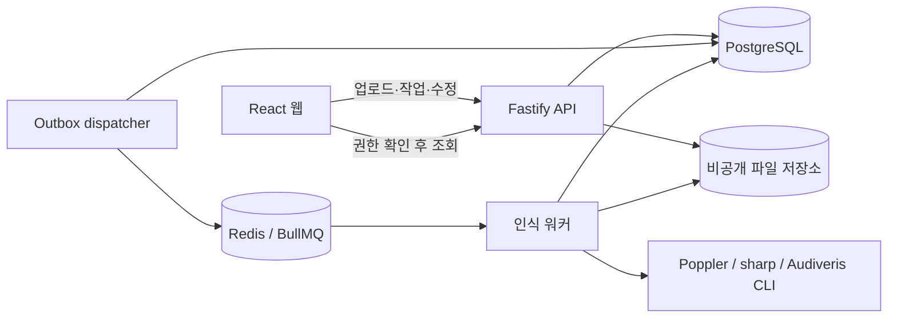

# Scorebridge 기술 설계

- 작성일: 2026-10-11
- 상태: 구현을 위한 설계안, 실제 인식 성능 및 라이브러리 호환성은 미검증
- 기준 문서: [제품 기획](./product-plan.md)
- 인프라 결정: OCI 사용. 자원·네트워크·비용·복구 계획은 [OCI 인프라 구성](./infrastructure-plan.md) 참조.
- 목표: 단선율 악보의 업로드 → 비동기 인식 → 원본 비교 → MusicXML 다운로드를 먼저 완성한다.

## 1. 기술 결정

| 영역 | 선택 | 이유 및 범위 |
| --- | --- | --- |
| 저장소 | pnpm workspace, TypeScript 모노레포 | 화면·API·워커의 계약과 음악 처리 코드를 공유 |
| 웹 | React + Vite + TypeScript | 로그인 후 작업하는 앱이므로 초기 SSR 불필요 |
| API | Fastify + JSON Schema, OpenAPI | 업로드·상태·다운로드·수정 API를 독립 운영 |
| DB | PostgreSQL, SQL migration | 작업 상태·시도·수정 버전을 트랜잭션으로 관리 |
| 큐 | BullMQ + Redis | 긴 인식 작업을 API 요청과 분리 |
| 워커 | Node.js 오케스트레이션 + Audiveris CLI | API와 계약을 공유하면서 Java 인식 프로세스 실행 |
| 이미지·PDF | sharp, Poppler 후보 | 이미지 정규화·썸네일, PDF 페이지 래스터화 |
| 악보 표시 | OpenSheetMusicDisplay(OSMD), SVG | MusicXML 미리보기; 편집 기능은 자체 구현 |
| 기본 재생 | Web Audio API | 최초 MVP는 단선율·고정 템포 재생 |
| 파일 | PoC 로컬 볼륨 → MVP 비공개 S3 호환 저장소 | 저장 방식은 StorageAdapter로 교체 |
| 개발 실행 | Docker Compose | PostgreSQL·Redis·API·워커의 재현 가능한 환경 |

PoC부터 PostgreSQL과 큐를 사용한다. SQLite에서 운영 DB로 옮기는 작업보다 작업 재시도·상태 복구를 처음부터 검증하는 편이 낫다고 판단했다. 단, 첫 엔진 실험은 웹·DB 없이 CLI로 실행한다.

모든 의존성은 설치 시 안정 버전을 선택해 lockfile과 컨테이너 이미지 digest로 고정한다. Node와 Java 런타임은 선택한 패키지 및 Audiveris 릴리스의 요구사항에 맞춘다. Java 버전과 headless 실행 가능 여부는 실제 컨테이너 실행으로 확인한다. 초기에는 GPU와 외부 생성형 AI API를 사용하지 않는다.

OSMD는 BSD-3-Clause 기반 MusicXML 렌더러이고 완전한 악보 편집기가 아니다. 오픈소스 기본 빌드에 재생 기능이 포함되어 있다고 가정하지 않는다. 관련 라이브러리와 컨테이너 의존성의 라이선스도 설치한 버전 기준으로 기록한다.

## 2. 시스템 구성



- API는 인식이 끝날 때까지 HTTP 연결을 유지하지 않는다.
- 웹은 처리 중에 2초 간격으로 상태를 조회하고, 비활성 탭에서는 간격을 늘린다. 완료·실패 시 중단한다. 초기에는 WebSocket 없이 구현한다.
- DB를 작업 상태의 기준으로 삼고 큐는 실행 전달에 사용한다.
- 큐 메시지에는 ID와 실행 세대만 넣는다. 악보 파일이나 전체 XML을 넣지 않는다.
- 워커는 한 번에 한 페이지를 인식하는 구성부터 시작하고 실제 메모리 사용량을 측정한 뒤 동시성을 늘린다.
- 공개 MVP는 인증·권한·처리 제한을 포함한 컨테이너 서버에 배포한다. 인식 워커를 짧은 실행 제한이 있는 서버리스 함수에 넣지 않는다.

## 3. 저장소 구조

```text
apps/
  web/                 업로드, 작업 상태, 결과 비교, 기본 편집
  api/                 HTTP API, 인증, 파일 접근, outbox dispatcher
  worker/              준비·인식·검증·정리 작업, 엔진 실행
packages/
  contracts/           API 스키마, 오류 코드, 작업 상태
  db/                  migration, query, transaction
  music/               MusicXML 파싱, 편집, 검증, 재생 이벤트
  storage/             로컬 및 S3 adapter
  omr/                 EngineAdapter, Audiveris adapter
infra/
  compose.yaml
  docker/
scripts/
  recognize-sample/     엔진 단독 실행
  evaluate/            정답 비교, 결과 CSV/JSON
fixtures/
  scores/              권리가 확인된 작은 테스트 악보
docs/
  product-plan.md
  technical-design.md
  evaluation/          실행 조건, 그룹별 측정 결과
```

업로드·엔진 중간 파일·비밀 값은 Git에 저장하지 않는다. 대규모 평가 자료는 별도 저장소에 두고 manifest로 연결한다.

## 4. 처리 파이프라인

### 4.1 입력 준비

1. API가 파일을 임시 영역에 스트리밍 저장한다. 실제 형식과 20MB 제한을 확인한다.
2. 임시 파일을 확정 저장하고 Upload 레코드와 준비 작업 outbox를 만든다. 중간 실패로 남은 파일은 정리 작업이 회수한다.
3. 준비 워커가 PDF 페이지 수·암호화 여부 또는 이미지 디코딩 가능 여부를 확인한다.
4. 최대 5페이지 입력에 대해 썸네일을 만들고 READY로 전환한다. 처음에는 전체 페이지 수가 5를 넘는 PDF를 거절한다.
5. 사용자가 준비된 페이지 목록에서 변환 대상을 선택한다.

이미지 픽셀 수, PDF 렌더 결과 크기와 실행 시간을 제한한다. 파일의 EXIF 방향을 적용하고 내부 파일명은 무작위 ID로 만든다. PDF 렌더링은 300 DPI를 초기 설정으로 측정하되 픽셀 상한을 우선한다.

### 4.2 인식

1. 선택 페이지를 고해상도 PNG로 준비한다.
2. 원본과 정규화 이미지를 구분해 저장한다. 기울기 보정은 비교 실험 후 켠다.
3. 페이지·실행별 전용 임시 디렉터리에서 Audiveris를 실행한다.
4. MusicXML 또는 압축 MXL 출력을 탐색한다. 하나의 페이지에서 여러 movement가 나온 경우 임의로 첫 파일만 선택하지 않고 진단 또는 복수 결과로 처리한다.
5. MXL은 엔트리 수·압축 해제 크기·경로를 제한해 해제한다. 정규 출력은 비압축 MusicXML로 저장한다.
6. XML 파싱·참조 검사·음악 규칙 검사를 수행하고 결과와 진단을 저장한다.
7. 완료 상태를 DB에 기록한다. 임시 디렉터리를 정리한다.

엔진 실행은 shell 문자열 대신 실행 파일과 인자 배열로 한다. 배치·내보내기 옵션은 선택한 릴리스 CLI로 확인한다. 종료 코드 0만으로 성공을 판정하지 않고 실제 결과 파일을 확인한다. 초기 hard timeout은 페이지당 180초로 제안하며 처리 시간 분포를 보고 조정한다. timeout과 취소 시 자식 프로세스까지 종료한다.

전처리의 crop·회전·resize 변환을 행렬로 기록해 엔진 좌표를 원본 이미지 좌표로 되돌릴 수 있게 한다.

### 4.3 여러 페이지의 의미

PoC와 최초 MVP는 페이지별 MusicXML 및 결과 묶음 ZIP을 제공한다. 페이지별 출력을 단순 XML 연결로 하나의 악보처럼 내보내지 않는다.

전체 곡 병합은 part·staff·voice 대응, 마디 순서, 페이지 시작에서 상속되는 조표·박자·음자리표, 페이지를 넘는 타이 등을 확인해야 한다. 별도 기술 검증에서 엔진의 문서 단위 실행과 페이지별 결과 병합을 비교한다. 신뢰할 수 있는 병합이 구현되기 전에는 UI에도 페이지별 결과임을 표시한다.

## 5. 데이터와 상태

| 테이블 | 주요 필드 |
| --- | --- |
| uploads | id, owner_id, original_artifact_id, state, page_count, error_code, expires_at |
| jobs | id, upload_id, owner_id, state, engine_version, options_hash, generation, deleted_at |
| pages | id, job_id, source_page_index, state, stage, active_attempt_id, original_result_id |
| attempts | id, page_id, generation, state, started_at, heartbeat_at, finished_at, error_code, timing |
| artifacts | id, storage_key, kind, checksum, size, created_at |
| score_revisions | id, page_id, version, base_version, xml_artifact_id, edit_operations, created_at |
| outbox | id, event_type, aggregate_id, generation, dispatched_at |

내부 ID와 화면의 마디 번호는 별도로 취급한다. 마디 번호에는 중복이나 누락이 있을 수 있으므로 편집에는 안정적인 내부 ID를 사용한다.

Upload: RECEIVING → PREPARING → READY / FAILED.

Job: QUEUED → PROCESSING → COMPLETED / PARTIAL / FAILED. 삭제 시 DELETING → DELETED.

Page: QUEUED → PROCESSING → SUCCEEDED / FAILED. stage는 NORMALIZING / RECOGNIZING / VALIDATING.

Job의 최종 상태는 선택한 페이지 상태에서 계산한다. 전부 성공이면 COMPLETED, 성공과 실패가 섞이면 PARTIAL, 전부 실패면 FAILED다. 실행 중인 페이지가 있으면 최종 상태로 전환하지 않는다.

## 6. 재시도·삭제·정합성

- DB transaction에서 상태 변경과 outbox 생성을 함께 수행한다. dispatcher가 미전송 이벤트를 큐로 보낸다. DB commit 후 큐 전송이 실패해도 복구할 수 있다.
- queue ID는 page ID와 generation으로 만든다. queue ID만을 중복 방지의 근거로 삼지 않는다.
- DB의 조건부 갱신으로 실행을 획득하고 heartbeat·기한·active attempt를 관리한다. 오래된 attempt는 결과를 확정할 수 없다.
- 결과는 attempt별 경로에 저장하고 active attempt와 generation이 일치할 때만 DB 참조를 갱신한다. 무효화된 결과 파일은 정리한다.
- 일시적인 인프라 장애만 최대 2회 자동 재시도한다. 잘못된 입력·미지원·동일 조건의 timeout은 자동 재시도하지 않는다.
- 수동 재시도는 실패 페이지에만 적용하고 generation을 갱신한다. 성공 결과와 사용자 수정본은 유지한다.
- Idempotency-Key를 owner·endpoint·payload hash와 연결한다. 같은 키로 다른 입력이 오면 409로 거절한다.
- 삭제 시 먼저 DELETING으로 전환해 새 실행과 다운로드를 거절하고 generation을 무효화한다. 늦게 완료된 워커가 결과를 복원하지 못하게 한다.
- 만료·삭제는 원본, 썸네일, 중간 파일, 결과, 수정본, ZIP을 모두 포함한다.

## 7. API契約

모든 경로는 `/api/v1` 아래다. PoC는 localhost로 제한된 개발 사용자로 실행하고, 공개 MVP는 인증된 owner로 접근을 제어한다. UUID의 추측 난이도를 권한 검사의 대체로 삼지 않는다.

| Method | Path | 動作 |
| --- | --- | --- |
| POST | /uploads | multipart 입력, 202로 upload ID와 PREPARING 상태 반환 |
| GET | /uploads/:id | 준비 상태와 페이지 목록 |
| POST | /jobs | upload ID와 선택 page index 입력, 202로 job ID 반환 |
| GET | /jobs | 자신의 이력, cursor pagination |
| GET | /jobs/:id | 페이지 상태, stage, 진단, 결과 목록 |
| POST | /jobs/:id/pages/:pageId/retry | 실패 페이지 재실행, 202 |
| GET | /jobs/:id/pages/:pageId/score | 현재 수정본 MusicXML과 revision |
| PATCH | /jobs/:id/pages/:pageId/score | baseVersion과 편집 조작 전송 |
| GET | /artifacts/:id | owner 확인 후 스트리밍 응답 |
| POST | /jobs/:id/exports | revision을 고정해 페이지별 MusicXML ZIP 생성, 202 |
| DELETE | /jobs/:id | 비동기 삭제, 202 |
| DELETE | /uploads/:id | 미사용 upload 삭제, 사용 중이면 409 |

공통 오류는 `{ code, message, requestId, retryable }` 형식이다. 예: UNSUPPORTED_FILE, PDF_ENCRYPTED, PAGE_LIMIT_EXCEEDED, ENGINE_TIMEOUT, NO_SCORE_DETECTED, INVALID_MUSICXML, UNSUPPORTED_EDIT, REVISION_CONFLICT. 내부 명령이나 파일 경로는 message에 포함하지 않는다.

공개 MVP는 같은 origin의 세션 cookie(HttpOnly, Secure, SameSite)와 CSRF 대책을 사용한다. 인증은 OIDC 등 검증된 구현을 선택한다. 계정별 대기 건수·동시 실행·일일 페이지 수에 상한을 둔다.

## 8. MusicXML과 편집

### 저장 기준

원래 인식된 XML은 변경하지 않고 보존한다. 편집용 XML 트리와 선택·검사·재생에 사용하는 파생 모델을 만든다. 지원하는 요소만 변경하며, 지원하지 않는 가사·강약·장식 등을 JSON 변환 과정에서 지우지 않는다. 서식이나 속성 순서의 완전한 일치보다 음악적 의미의 보존을 검증한다.

파생 모델의 note는 내부 ID, part, measure, staff, voice, onset, duration, pitch, rest, tie 정보를 갖는다. 시간은 유리수 또는 정수 ticks로 표현해 부동소수점 오차를 피한다.

MusicXML의 backup·forward, chord, divisions에 따라 위치를 계산한다. 여러 성부의 음표 duration을 모두 더해 마디 길이로 판단하지 않는다. grace note, tuplet, tie, 이조 등은 지원 여부를 명시적으로 판정한다.

### MVP 편집 조작

- setPitch: step / alter / octave를 명시하며 임시표 표시와 음높이를 일치시킨다.
- setDuration: duration / type / dot을 일치시킨다.
- setRest: 음표와 쉼표를 전환한다.
- insertNote / deleteNote: 단선율에서 빠진 음표나 추가된 음표를 수정한다.

초기 편집은 단일 성부의 일반적인 음표·쉼표를 중심으로 한다. 길이 변경과 삽입·삭제는 같은 성부의 후속 onset을 재계산하며, 마디 경계를 자동으로 넘지 않는다. 불일치는 사용자에게 수정을 요청한다. 화음·연음·타이 음표 등 의미를 보장할 수 없는 조작은 이유와 함께 거절하고 외부 편집으로 안내한다. 이런 제한이 빈번해 수정 시간 목표를 충족하지 못하면 MVP 지원 범위를 재검토한다.

조작은 `{ baseVersion, operations: [...] }`로 전송한다. 서버에서 검증·적용하고 새 revision을 생성한다. 오래된 version은 409로 거절한다. 클라이언트의 낙관적 반영은 실패 시 되돌린다. undo/redo도 revision과 동기화한다. 인식 재실행 결과로 수정본을 덮어쓰지 않는다.

OSMD의 내부 객체를 저장 모델로 사용하지 않는다. XML에서 다시 렌더링하고 어댑터로 내부 note ID와 표시 위치를 연결한다. 음표 선택의 hit test와 재렌더링 시간은 초기 기술 검증에서 측정한다.

## 9. 검사·재생·원본 대응

검사는 XML 구조·part 참조·양의 duration·성부별 시간 범위·마디 용량을 확인한다. 못갖춘마디, 자유 박자, grace, tie를 고려하고 미지원 요소는 warning으로 표시한다. 중대한 구조 오류는 실패로 처리하며, 음악적으로 의심되는 부분은 결과를 표시하면서 warning으로 알린다.

기본 재생은 파생 모델에서 이벤트를 만들고 AudioContext의 시계를 기준으로 미리 예약한다. 재생은 사용자 조작으로 시작한다. 고정 템포·피아노에 가까운 간단한 음색부터 시작하며 강약·반복·장식의 완전한 재현은 초기 범위에서 제외한다. 정지·편집·페이지 전환 시 예약을 취소한다. 타이와 임시표를 올바르게 해석하지 못하는 악보는 재생을 제한한다.

원본 마디 대응은 sidecar JSON으로 `{ pageId, measureId, bbox, coordinateSpace, provenance }`를 갖는다. Audiveris 중간 결과에서 확보할 수 있는지 실험한다. OSMD의 표시 좌표와 원본 이미지 좌표를 구분한다. 확실한 대응이 없으면 페이지 비교를 제공한다.

## 10. 운영·검증

초기 공개 구성은 단일 VM의 reverse proxy, web/API, dispatcher, 워커, PostgreSQL, Redis다. 파일은 S3 호환 저장소를 사용한다. CPU·메모리는 실측으로 결정한다. DB 백업과 파일 삭제의 반영 기한도 정한다.

워커는 비root 권한, 입력별 전용 영역, CPU·메모리 제한으로 실행한다. 외부 통신은 저장소 등 필요한 대상으로 제한하고 XML 외부 참조는 비활성화한다. MXL과 export ZIP은 경로 탈출과 압축 해제 상한을 검사한다.

로그는 request / job / page / attempt ID로 연결한다. 큐 대기 시간, 실제 처리 시간, 최대 메모리, 단계별 실패율, 고립 파일 수를 기록한다. 악보 내용과 서명 URL을 로그에 저장하지 않는다.

주요 검증:

- 자작 fixtures로 임시표, 쉼표, 부점, backup/forward, 타이, 못갖춘마디를 검사한다.
- XML 읽기 → 제한된 편집 → 내보내기에서 변경 대상 외의 의미를 보존한다.
- 실제 엔진으로 단일 페이지를 MusicXML로 변환하고 OSMD와 외부 편집기에서 확인한다.
- 워커 중단, 중복 전달, DB 갱신 전 충돌, 삭제 후 늦은 완료를 재현한다.
- 다른 owner의 상태 조회·파일 조회·편집을 거절한다.
- PDF·여러 페이지·일부 실패·ZIP·수정본 다운로드를 E2E로 확인한다.
- 레이아웃은 브라우저에서 확인하며 직렬화 일치만으로 판정하지 않는다.

평가 manifest에는 권리 근거, 곡 ID, 입력 유형, 정답 XML, checksum을 기록한다. 음표 sequence alignment로 삽입·삭제·치환을 세고 마디·성부·음높이·길이의 정확성도 측정한다. 튜닝과 최종 평가는 곡 단위로 분리한다. 실패 페이지는 별도 집계하고 정확도 평가에서 임의로 제외하지 않는다.

## 11. 구현 순서와 종료 조건

| 단계 | 내용 | 종료 조건 |
| --- | --- | --- |
| T0 | 고정 엔진·자작 샘플·CLI 실행 | headless 변환, MXL 해제, MusicXML 표시, 시간·메모리 기록 |
| T1 | OSMD 표시·음표 선택·XML 제한 편집·재출력 실험 | 부점·임시표 등의 보존과 외부 편집기 읽기를 확인 |
| T2 | workspace·Compose·DB·contracts | API와 워커 기동, migration과 health check 통과 |
| T3 | 이미지 1장 전체 흐름 연결 | upload → queue → 실제 엔진 → 비교 → download 동작 |
| T4 | PDF·5페이지·retry·export | 일부 실패와 재시작 시 성공 결과 보존 |
| T5 | PoC 평가 | 제품 기획 기준으로 MVP 범위·엔진 채택 판단 |
| T6 | 인증·제한 편집·재생·삭제·운영 | 공개 MVP 완성 기준 충족 |

T0/T1 실패 시 UI를 확장하기 전에 엔진이나 편집 방식을 변경한다. PoC의 완료는 T5다. T6 일반 공개 전에 라이선스 의무, 인증, 접근 제어, 보관·삭제를 확정한다.

## 12. 공식 참고 자료

- [Audiveris CLI](https://github.com/Audiveris/audiveris/wiki/CLI-Arguments): 배치 실행과 MusicXML export. 선택한 릴리스에서 재확인한다.
- [Audiveris repository / license](https://github.com/Audiveris/audiveris): 초기 엔진 후보, AGPL-3.0.
- [OSMD repository](https://github.com/opensheetmusicdisplay/opensheetmusicdisplay): MusicXML 렌더링, BSD-3-Clause, 편집 기능 범위.
- [BullMQ retry](https://docs.bullmq.io/guide/retrying-failing-jobs): 재시도 설정.
- [BullMQ idempotent jobs](https://docs.bullmq.io/patterns/idempotent-jobs): 중복 실행에 대응하는 처리.
- [MusicXML backup](https://www.w3.org/2021/06/musicxml40/musicxml-reference/elements/backup/): 여러 성부의 시간 위치.

자료 확인일: 2026-10-11. 기술 선택은 본 설계의 판단이며 라이브러리 광고나 연구 정확도를 Scorebridge의 실측으로 간주하지 않는다.
